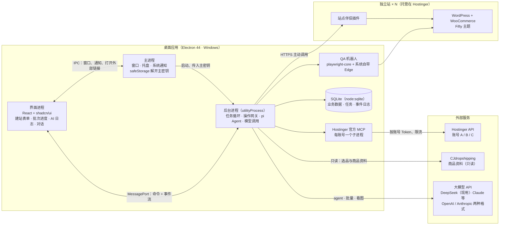
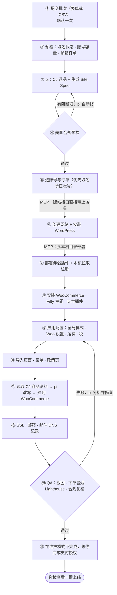

# 独立站 AI 工厂 —— 基于 WordPress + WooCommerce + Hostinger 的个人建站与运营工具

> 方案版本 v0.9 · 2026-10-15（v0.9：CJ 只当商品资料库，你们自己供货发货，见决策 4 和 4.2.8；表单新增必填「发货时效」；v0.8：同步 shopunitycart.com 实际建站结果，见 poc-results.md 第四轮；v0.7：做成 Electron 桌面应用，数据库定为 SQLite（Electron 自带的 `node:sqlite`），见决策 I、J 和第 3、7、8 节；v0.6：同步 P0 第一轮验证结果，见 [poc-results.md](poc-results.md)；v0.2：写入 10 项已确认决策；v0.3：模型暂用 DeepSeek，同时支持 OpenAI 和 Anthropic 两种 API 格式；v0.4：UI 用 shadcn/ui，建站改为「表单 + 选已购域名 → 经 Hostinger MCP 批量全自动」，可实时查看进度和 AI 日志，见决策 D–G 和 4.2 节；v0.5：表单只填关键信息，其余由 AI 按惯例决定，见决策 H 和 4.2.1–4.2.2）
> 外部能力（Hostinger API/MCP、WordPress、WooCommerce、CJdropshipping、pi、Fifty、DeepSeek API、Claude API）已于 2026-10 查证，出处见附录；标注「待 POC 验证」的点在动工前必须实测。

---

## 0. 一句话定位

一个**跑在你自己电脑上的 Windows 桌面应用（Electron）**：控制台里内嵌 **pi** 作为 AI Agent，由它完成建站、选品、改内容、操作 Hostinger / 域名 / 邮箱等所有 AI 指令。工具统一纳管多个 Hostinger 账号的主机、域名和商业邮箱；你在表单里选好已购域名、填好必要信息，系统就通过 Hostinger 官方 MCP 直接在 Hostinger 上**批量、并行**生成网站：从 **CJdropshipping** 的商品库取商品资料（你们自己供货、自己发货），基于 **Fifty** 区块主题生成**符合美国市场规范**的 WooCommerce 独立站，进度和 AI 日志实时可见。内容类修改自动执行并留快照，DNS、插件、花钱、删除类操作必须经过你确认。

### 0.1 决策记录（2026-10-14 已确认）

| # | 决策 | 结论 | 对方案的影响 |
|---|---|---|---|
| 1 | 使用形态 | **完全自用的个人工具** | 去掉多用户、角色权限、多租户；「审批」简化为你本人的「确认」 |
| 2 | Hostinger 套餐 | **Business/Premium、Cloud、Agency 都有** | 适配层同时支持 `hosting_*` 和 `agency-hosting_*` 两条建站路径；新站默认放 Agency（API 最完整） |
| 3 | 目标市场 | **美国** | 合规规则引擎 P1 只做美国规则集；欧盟/英国推到 P3 |
| 4 | 商品来源 | **CJdropshipping 只当商品资料库；你们自己供货、自己发货**（v0.9 修正） | 只读取 CJ 的商品信息、图片、规格和价格，改写后直接建到 WooCommerce；不做 CJ 店铺授权、刊登、下单，站点不装 CJ 插件 |
| 5 | 主题基底 | **Fifty**（RegionallyFamous/fifty）原生区块主题，只加自己的模式库和风格变体 | fork Fifty 的 Obel 主题进仓库自己维护；所有站共用一套主题，差异放在每站的全局样式里 |
| 6 | AI 改内容 | **自动执行 + 快照** | 文案/图片/样式/商品描述直接生效，可一键回滚 |
| 7 | 技术栈 | **TypeScript 全栈** | Node.js 24 单进程 |
| A | AI 入口 | **控制台内置 pi 作为 Agent**，负责建站和执行各种 AI 指令 | pi 用 SDK 内嵌；只开放我们的自定义工具，关闭它自带的 bash/write/edit；不再单独做平台 MCP Server |
| B | 部署位置 | **只在本机运行** | 数据库改用 SQLite；站点注册改为本机主动拉取；关机期间监控和定时任务暂停，开机补跑 |
| C | 模型 | **暂用 DeepSeek；系统同时支持 OpenAI 格式和 Anthropic 格式的 API** | 模型层统一用 pi 自带的 `pi-ai`；提供方和模型在控制台配置，按角色（agent / vision / bulk / review）路由，换模型不改代码 |
| D | UI 框架 | **shadcn/ui** | Vite + React + shadcn/ui（Tailwind）；表单、数据表、进度、日志都用它的组件 |
| E | 建站入口 | **表单填必要信息 + 选 Hostinger 已购域名 → 自动调用 Hostinger MCP 建站** | 字段清单见 4.2.1；提交时确认一次，之后全自动；Hostinger 调用改为经官方 MCP（每账号一个本机进程） |
| F | 批量与可观测 | **批量生成、多任务并行；实时查看进度和 AI 日志** | 批次 + 每站流水线 + 按账号限流；事件写库并通过 MessagePort 实时推送到界面（4.2.4、4.2.6） |
| G | 本地环境 | **网站直接建在 Hostinger 上，本机不需要 WordPress 环境** | 本机只跑这个桌面应用（含 MCP 子进程）；开发插件和主题时用 Hostinger 测试站或 WordPress Playground（8.1） |
| H | 表单范围 | **只填关键信息（域名、类目、经营主体、地址、邮箱、电话），其余由 AI 按行业惯例决定** | 必填 7 项（每站 2 项、批次 5 项，含发货时效）；政策、页面、风格、定价等按 4.2.2 的规则自动生成，事后可在对话里改；AI 不编造事实，对买家的承诺在提交前列出给你确认 |
| I | 应用形态 | **Electron 桌面应用** | 界面、主进程、后台进程（`utilityProcess`）三类进程，用 `MessagePort` 通信，不监听本地端口；关窗口后最小化到托盘继续运行；主密钥用 `safeStorage`（Windows DPAPI）保护；打包成 Windows 安装包（第 3、7、8 节） |
| J | 数据库 | **SQLite** | 用 Electron 44 自带的 `node:sqlite`（Node 24.21），不需要编译原生模块（POC 已验证）；不用 ORM，SQL 迁移文件按 `PRAGMA user_version` 顺序执行 |

---

## 1. 需求细化

### 1.1 原始需求 → 细化后的能力

| 原始需求 | 细化后的系统能力 | 阶段 |
|---|---|---|
| 一键生成独立站 | 填表单（选 Hostinger 已购域名 + 必要信息，可批量）→ 确认一次 → pi 选品并生成结构化 **Site Spec** → 美国合规预检 → 流水线经 Hostinger MCP 在 Hostinger 上建站（建网站、装 WP + WooCommerce + Fifty 主题）→ 导入页面、政策页、商品 → QA 自动验收 → 你检查后上线；全程实时显示进度和 AI 日志 | P1 |
| 生成符合规范的站点 | **美国合规规则引擎**：隐私政策、退换货与运输政策、FTC 评价与邮购规则、无障碍、Prop 65、支付平台与 Google Merchant Center 审核要点、SEO、性能、安全、邮件认证；上线前必须通过 | P1 |
| 接入 AI | pi 内置 Agent（对话式操作一切）+ 批量 AI 任务（商品文案、SEO；不着急的排到 DeepSeek 低谷时段，价格减半）；模型可在 DeepSeek、Claude 及其他 OpenAI/Anthropic 格式的服务间切换 | P1–P2 |
| 接入 Hostinger 插件或 MCP | 所有 Hostinger 操作都经官方 **MCP**（`@hostinger/mcp`，每账号一个本机进程，由操作网关调用）；pi 通过网关包装的工具间接使用，P2 起长尾操作按白名单透传；站点内用 Hostinger 自带插件（LiteSpeed Cache 等） | P1–P2 |
| 多实例管理 Hostinger | 多账号接入（每账号一个 API Token，加密存储）、资源同步、容量调度、按账号限流、到期/续费看板 | P1 |
| 管理域名 | 可用性查询、购买（需确认）、续费、锁定/隐私保护、NS 修改、DNS 增删改 + 快照回滚、转发 | P1–P2 |
| 管理商业邮箱 | 邮箱套餐/配额、邮箱增删改密、别名、转发、Catch-all、自动回复、MX/SPF/DKIM/DMARC 检查与修复 | P1–P2 |
| 独立站与域名绑定 | 同账号 / 跨 Hostinger 账号 / 外部注册商三种路径：预检、变更 diff、执行、解析验证、SSL、回滚 | P1 |
| AI 操作 Hostinger、域名、邮箱 | pi 通过操作网关的受控工具操作；按风险分级自动执行或弹确认卡片 | P2 |
| AI 随时修改站点内容 | 对话式改页面/样式/菜单/商品/政策页；每次修改生成 changeset + 快照，可预览、可回滚、可定时恢复 | P1–P2 |
| 管理这些独立站 | 站点看板（状态、域名、SSL、版本、订单、销售额、合规分）、批量更新、备份、监控、模板 | P1–P2 |

### 1.2 补充的必需能力

1. **风险分级 + 确认**：pi 本身没有权限系统，所以由我们的工具层强制拦截。买域名、删站、改 NS 永远要你点确认。
2. **快照与回滚**：内容变更前存快照；DNS 变更前用 Hostinger 的 `dns_snapshots_*` 打快照。
3. **审计日志**：记录每一次 AI 和你本人的操作（对象、参数、结果）。
4. **资产到期看板**：域名、主机、邮箱到期日和自动续费状态，提前 30/7/1 天提醒。
5. **监控**：站点和结账页可用性、SSL 到期、24 小时零订单（本机运行时生效，见 4.9）。
6. **模板与克隆**：沉淀「品类 × 风格」模板，保证新站的质量下限。
7. **批量操作**：跨站点批量更新插件、改价、改文案。
8. **成本看板**：大模型 API 花费（按站点、按功能、按模型）、Hostinger 订阅费用。
9. **密钥安全**：Hostinger Token、WP 应用密码、Woo Key、邮箱密码统一加密，**永远不进入 AI 上下文**。
10. **漂移检测**：在 hPanel 或 WP 后台手工改过的东西，同步时能发现并提示。
11. **本机数据备份**：SQLite 文件和主密钥要备份，否则换电脑或硬盘损坏会丢失站点凭据和快照。

### 1.3 明确不做（YAGNI）

- **多用户、角色权限、多租户、对外 SaaS**：个人工具用不到。以后要开放给别人用，再加用户表和 Workspace。
- **平台 MCP Server**：pi 在进程内直接调用我们的工具，不需要再套一层 MCP。哪天想用 Claude Code 驱动平台时再加。
- **让 AI 写主题代码或任意 HTML/PHP**：AI 只产出结构化内容，渲染交给 Fifty 主题和模式库。新增模式属于开发工作（P2 的「模式工坊」，需要你审阅后合并）。
- **重做 WooCommerce 后台**：订单处理、发货、退款仍在 WooCommerce 里完成（你们自己发货），这里只做聚合看板和常用动作。
- **多主机商适配层**：只对接 Hostinger。
- **单站多语言**：美国市场，英语单语言。
- **规避平台风控类功能**：多账号只用于故障隔离和业务分组，遵守 Hostinger 和 CJ 的服务条款。

---

## 2. 能力边界调研结论（2026-10）

### 2.1 Hostinger Public API

- Base URL：`https://developers.hostinger.com`，路径形如 `/api/{product}/v1/...`
- 认证：hPanel → API 生成 Token，`Authorization: Bearer <token>`；**一个 Token 对应一个账号**
- 限流：**90 次/分钟**（按用户计），超限返回 `429` 和 `Retry-After`
- Mail API 是独立服务 `https://api.mail.hostinger.com`

与本系统相关的操作（名称取自官方 MCP 的 operation 名，与 REST 端点一一对应）：

| 分组 | 关键操作 | 用途 |
|---|---|---|
| hosting（Business/Premium、Cloud） | `hosting_orders_list`、`hosting_websites_list/create/delete`、`hosting_websites_start-setup`、`hosting_websites_list-setups` | 在已有主机订单上建网站、发起 WordPress 安装、轮询进度 |
| hosting | `hosting_ssl_install/status/toggle-https-redirect`、`hosting_domains_*-subdomain*`、`hosting_domains_*-website-parked`、`hosting_redirects_*`、`hosting_php_*`、`hosting_cache_*`、`hosting_databases_*`、`hosting_files_*` | SSL、子域/停放域名、重定向、PHP、缓存、数据库、文件 |
| agency-hosting（Agency） | `agency-hosting_website-setups_create/status`、`agency-hosting_websites_*`、`agency-hosting_wordpress_*`、`agency-hosting_ssl_*` | 建站时可直接带 WordPress 管理员、标题、语言；无域名时自动分配 `*.hostingersite.com` 临时域名 |
| wordpress | `wordpress_installations_install/list/update-core`、`wordpress_plugins_install/activate/deactivate/deploy/update/uninstall`、`wordpress_themes_install/activate/deploy`、`wordpress_login_create-links`、`wordpress_lite-speed_purge`、`wordpress_maintenance_toggle` | 装 WP、按 slug 装插件（含 `woocommerce`）、**上传自有插件/主题 zip**、一次性登录链接、清缓存、维护模式 |
| domains | `domains_availability_check`、`domains_portfolio_list/get/purchase/update-nameservers/enable-lock/enable-privacy-protection/renewal-information`、`domains_forwarding_*`、`domains_transfer_*`、`domains_whois_*` | 查询、购买、改 NS、锁定、隐私、转发、转入、WHOIS 联系人 |
| dns | `dns_records_list/update/delete/validate/reset`、`dns_snapshots_list/get/restore` | 改之前先校验；**快照可一键回滚** |
| mail | `mail_mailboxes_list/create-mailbox/delete-mailbox/change-mailbox-password`、别名、转发、Catch-all、自动回复、Webhooks、日志、`mail_orders_list/plan` | 商业邮箱全生命周期 |
| billing | `billing_catalog_list`、`billing_orders_create-purchase`、`billing_subscriptions_*`、`billing_payment-methods_*` | 价格目录、下单、续费；**全部归为 L3** |

### 2.2 Hostinger 官方 MCP（`@hostinger/mcp`）

- Node.js 24+；用 `HOSTINGER_API_TOKEN` 鉴权；stdio 或 `--http` 两种传输方式
- 只暴露 3 个元工具：`search`、`execute`、`multi-execute`，背后是 400+ 个操作，**包括删站和下单**
- **一个进程只绑定一个账号**；远程托管版 `https://mcp.hostinger.com` 用 OAuth 登录

- `hosting_deploy-wordpress-plugin` / `hosting_deploy-wordpress-theme` **直接从本机目录部署**插件和主题，上传凭据由 MCP 内部生成；`agency-hosting_website-setups_create` 建站时可以直接带上域名和 WordPress 管理员、标题、语言

**结论（决策 E）**：Hostinger 的所有调用都经过官方 MCP。操作网关作为 MCP 客户端，**每个账号启动一个本机 stdio 进程**（注入该账号的 Token，空闲时自动关闭），流水线代码确定性地调用 `execute`。好处：
- 不用自己写 400 多个接口的客户端，参数 schema 由 Hostinger 维护（可以用 `search` 查询）
- MCP 进程在本机运行，可以直接部署本机目录里的伴侣插件和主题

MCP **不直接交给 pi**：pi 只能通过网关包装过的、带风险分级的工具间接使用。如果 POC 发现个别操作经 MCP 调用有问题，就对那个操作单独改为直接调 REST。

### 2.3 Hostinger Mail API

收发信、搜索/整理/回复/草稿、Webhooks、投递日志；提供 Node/PHP/Python SDK、CLI、MCP。定位是中等量级的交易邮件，不适合群发。

### 2.4 WordPress / WooCommerce

| 能力 | 现状 | 本系统怎么用 |
|---|---|---|
| WP REST API + **Application Passwords** | 核心功能，稳定 | 本机调用站点的主通道 |
| WooCommerce REST API v3（Key/Secret，支持 batch） | 稳定 | 商品、订单、设置读写；POC 已验证可以直接用伴侣插件的应用密码调用 |
| Abilities API（WP 6.9 起进核心） | 稳定中 | 伴侣插件把「改区块、改样式」等注册为 Ability |
| MCP Adapter / WooCommerce MCP | pre-1.0 / 开发者预览 | 暂不使用；本机直接调 WP / Woo 的 REST API |

### 2.5 pi（Agent 内核）

- 项目：`earendil-works/pi`（原 `badlogic/pi-mono`，作者 Mario Zechner），MIT 协议，要求 Node.js ≥ 22.19
- npm 包：`@earendil-works/pi-coding-agent`（含 SDK）、`@earendil-works/pi-ai`（多厂商 LLM 统一接口）、`@earendil-works/pi-agent-core`（Agent 运行时）等
- **SDK 嵌入**：`createAgentSession()` → `session.prompt()`；`session.subscribe()` 接收流式事件（`message_update`、`message_end`、`agent_settled`），可直接推给网页；支持 `abort()`、`steer()`、`followUp()`
- **工具控制**：`customTools` 注入自定义工具；`tools`、`noTools`、`excludeTools` 控制内置工具（内置只有 read、write、edit、bash 四个）
- **会话**：`SessionManager` 默认持久化，也可 `SessionManager.inMemory()`
- **扩展**：可在 SDK 中加载 MCP 扩展（`createMcpExtension()`）等；用自定义 `ResourceLoader` 完全掌控加载哪些扩展
- **没有权限系统**：没有工具调用确认弹窗。安全只能靠「只给它安全的工具」+「我们的工具层拦截」
- 模型：底层的 `@earendil-works/pi-ai` 内置 DeepSeek（读 `DEEPSEEK_API_KEY`）、Anthropic、OpenAI 等数十个提供方；协议层支持 `openai-completions`、`anthropic-messages`、`openai-responses` 等，并可用 `createProvider()` 注册自定义 `baseUrl` 的提供方；工具参数用 TypeBox schema 定义

### 2.6 CJdropshipping

- **官方 MCP**（POC 实测）：地址是 `https://developers.cjdropshipping.com/mcp/<accessToken>`。accessToken 用 API Key 通过 REST 换取，有效期 180 天，本身就是 `API@<userId>@CJ:…` 格式，原样拼接；它在 URL 里，按密钥对待。实际有 70 个工具，覆盖选品、库存、运费与时效、**店铺授权（`get_authorize_url`）、刊登（`publish_product_async`）**、商品关联、订单、纠纷，每个工具都带只读/写入/破坏性标注；限速为读 10 次/秒、写 2 次/秒、并发 5
- **REST API**：`/product/listV2` 选品（关键词相关性一般，需要 pi 二次筛选或改用类目 ID）
- **本系统只用 CJ 的只读能力**：搜商品、商品详情（标题、多张图、HTML 描述、材质、重量、类目）、规格（颜色尺码组合、成本价、尺寸、规格图）。授权、刊登、关联、下单、支付等工具一律不在白名单里
- **版权提醒**：CJ 的图片和描述是给在 CJ 采购的卖家用的，不从 CJ 进货时直接使用可能违反 CJ 条款或侵犯原作者版权。文案由 pi 重写；图片正式上线前优先换成供应商授权或自己拍摄的

### 2.7 Fifty（主题基底）

- `RegionallyFamous/fifty`：一组**独立的** WooCommerce 区块（FSE）主题（不是子主题，也不是框架），GPL-2.0-or-later，可商用、可 fork、可改品牌
- 每个主题由 `theme.json`（设计系统）+ 区块模板 + 很小的 `functions.php` 组成；没有 JS 打包、没有构建步骤、没有自定义区块
- 其中 **Obel** 带完整的 WooCommerce 皮肤（购物车、结账、迷你购物车、评价、筛选、订单确认页）和约 10 个起步模式（hero、精选商品、FAQ、评价、页脚等）
- 仓库由 AI Agent 构建，自带 `AGENTS.md`、每个主题的 `SYSTEM-PROMPT.md`、lint、区块校验、视觉回归脚本（`bin/snap.py`）；内置一个叫 Woo-drow 的 Agent 角色，可关闭
- **风险**：目前 3 star、1 fork，属于早期个人项目 → **fork 进仓库自己维护**，不依赖上游更新

### 2.8 DeepSeek API（当前使用的模型）

- **两种格式**：OpenAI 格式 `https://api.deepseek.com`（`/chat/completions`）；Anthropic 格式 `https://api.deepseek.com/anthropic`（`x-api-key` 鉴权）
- **模型**：

| 模型 | 对应版本 | 上下文 | 思考模式 | 工具调用 | JSON 输出 | 看图 | 并发上限 |
|---|---|---|---|---|---|---|---|
| `deepseek-v4-pro` | DeepSeek-V4-Pro-0813 | 1M | 支持（默认开） | 支持 | 支持 | **不支持** | 500 |
| `deepseek-flash` | DeepSeek-V4.1-Flash | 1M | 支持（默认开） | 支持 | 支持 | **支持** | 2500 |

- **Anthropic 兼容层的限制**：忽略 `cache_control`、`disable_parallel_tool_use`、`tool_result` 里的 `is_error`、`mcp_servers`、`top_k`；`thinking.budget_tokens` 被忽略；不支持 `document` 等内容块；传入 `claude-*` 模型名会被映射成 DeepSeek 模型
- **限流**：按账号限制并发，超出返回 `429`；排队期间会发送空行或 `: keep-alive` 注释，解析器要能容忍
- **没有批处理接口，但低谷时段价格减半**（见 6.3）
- **模型会改名或退役**：旧名 `deepseek-v4-flash` 等已退役并自动转到新模型 → 模型 ID 只写在配置里，不写死在代码里

### 2.9 由此得出的设计决定

1. **确定性流程用代码，pi 负责「想」和「指挥」**：pi 生成 Spec、选品、写文案、看 QA 截图、修合规问题，然后调用工具触发流水线；建站的每一步仍是代码（幂等、可重试、可回滚）。pi 不直接碰 Hostinger 或 CJ 的原始接口。
2. **pi 只看得到我们的自定义工具**：关闭内置 bash/write/edit/read；外部 MCP（Hostinger、CJ）由操作网关消费，按白名单和风险分级包装后才给 pi。
3. **站点内操作靠「站点伴侣插件」**：经 Hostinger MCP 从本机目录部署和激活，本机通过 HTTPS 主动调用，不需要 SSH，站点也不需要回连本机。
4. **所有站共用一套 Fifty 主题**：每站的色板、字体等差异存在该站的全局样式里，由伴侣插件写入。主题升级一次即可覆盖所有站。

---

## 3. 总体架构（Electron 桌面应用）



- **三类进程，各管一摊**：
  - **界面进程**：只负责显示和交互。开启 `contextIsolation` 和 `sandbox`，不能直接使用 Node
  - **主进程**：管窗口、托盘、系统通知、开机自启和单实例锁。启动时用 `safeStorage` 解开主密钥，交给后台进程
  - **后台进程**（`utilityProcess`）：所有业务逻辑都在这里，包括任务循环、操作网关、pi、模型调用、MCP 客户端、SQLite。它崩溃不会带垮界面；主进程会自动把它拉起来，任务从断点继续
- **界面和后台直接用 `MessagePort` 通信**：命令走请求/响应，进度和 AI 日志走事件流推送。**应用不监听任何本地端口**
- **Hostinger MCP 子进程**：每个账号一个，由后台进程用 Electron 可执行文件以 Node 模式（`ELECTRON_RUN_AS_NODE`）启动，空闲时关闭（POC 已验证可行）
- **关闭窗口不退出**：默认最小化到托盘，监控和批量任务继续跑；可以选开机自启
- **本机不需要 WordPress**：网站直接建在 Hostinger 上
- **所有连接都是本机主动发出的**：站点和外部服务不需要连回你的电脑
- 订单在 WooCommerce 里由你们自己处理和发货，**和这台电脑是否开机无关**

---

## 4. 核心模块设计

### 4.1 多账号（多实例）管理

**接入**：hPanel 生成 API Token → 控制台录入（命名、套餐类型、用途标签）→ 校验（调 `hosting_orders_list`、`domains_portfolio_list`）→ 加密入库 → 首次全量同步。

**同步器**（本机开着时定时跑，开机时先补一次）：

| 资源 | 频率 | 用途 |
|---|---|---|
| 主机订单、网站列表、网站数上限 | 30 分钟 | 容量调度、漂移检测 |
| 域名组合（到期、锁定、隐私、NS） | 6 小时 | 到期看板、绑定预检 |
| 订阅（自动续费状态） | 每天 | 续费提醒 |
| 邮箱订单、配额、邮箱列表 | 6 小时 | 邮箱管理 |
| DNS 记录 | 变更前实时拉取 | 变更 diff |

**容量调度**：新建站点时选「账号 + 订单」，按以下顺序：
1. **域名所在账号**有空余网站名额的订单。这样直接带域名建站，不需要跨账号改 DNS
2. 同一账号内，优先 **Agency**（建站 API 能直接带 WP 管理员和语言），然后 Cloud，最后 Business/Premium
3. 域名所在账号没有名额时，放到其他账号，之后做跨账号绑定
4. 表单里也可以手动指定账号和订单

**域名下拉数据**：来自同步下来的域名组合，标注每个域名所属账号、到期日、是否已有网站或邮箱、当前 NS 是否是 Hostinger 的，供表单选择。

**按账号限流**：每账号一个令牌桶，设 60 次/分钟（给 90 的上限留余量）；遇到 `429` 按 `Retry-After` 退避。

**跨账号关系显式建模**：域名、主机、邮箱可以分属不同账号，每条资源都带 `account_id`，绑定关系单独成表。

### 4.2 一键建站：表单 → 批量全自动

整体流程：**填表单（选一个已购域名 + 必要信息）→ 提交时确认一次 → 后台自动调用 Hostinger 官方 MCP 在 Hostinger 上建站 → 控制台实时显示进度和 AI 日志**。支持一次提交多个站，多个站并行生成。

#### 4.2.1 建站表单：只填关键信息

表单只收**系统无法自己知道的真实信息**，其余全部由 AI 按行业惯例决定（见 4.2.2）。★ = 必填。

**每站（批量时，表格里每行一个站）**

| 字段 | 必填 | 留空时 | 说明 |
|---|---|---|---|
| 域名 | ★ | — | 从 Hostinger 已购域名中选；下拉列表显示所属账号、到期日、是否已有网站或邮箱，默认只列未使用的 |
| 商品类目 | ★ | — | 例如 dog beds；可以填多个 |
| 商品数量 | | 20 | 首批上架数量 |
| 售价区间（美元） | | AI 按类目定 | 例如 19–79 |
| 品牌名 | | 从域名推断 | 例如 nordicpaws.com → Nordic Paws |

**经营主体与联系信息（一个批次填一次，可以保存后复用）**

| 字段 | 必填 | 留空时 | 说明 |
|---|---|---|---|
| 主体类型 | | 公司 | 公司 / 个人 |
| 主体名称 | ★ | — | 公司法定名称，或个人经营者姓名 |
| 地址 | ★ | — | 在页脚和联系页公开显示；Google Merchant Center 和支付平台审核都会看；也作为默认退货地址 |
| 客服邮箱 | ★ | 自动创建 support@域名 | 只有该域名已有 Hostinger 邮箱订单时才能自动创建（预检会查）；没有就改填一个已有邮箱 |
| 客服电话 | ★ | — | |
| 发货时效 | ★ | — | 处理时效 + 运输时效，各填「最少–最多」个工作日（例如处理 1–3、运输 5–10）。你们自己发货，只有你知道；原样写进运输政策和 FAQ，代码会核对 AI 写出的天数（FTC 邮购规则要求有依据） |

表单字段由一份 zod schema 定义，同时用作 CSV 导入模板和 Site Spec 的输入。

#### 4.2.2 AI 自动决策的规则

下面这些不出现在表单里，由 pi 按规则决定。规则写在系统提示词和代码里，保证每次生成的结果可预期。生成后都能在对话里让 pi 修改（L1，自动执行 + 快照）。

| 项目 | 默认决策 | 约束 |
|---|---|---|
| 品牌标语、Logo | 按品牌名和类目生成；Logo 用文字 Logo | 不使用他人商标或近似名称 |
| 风格、配色、语气 | 按类目从风格库匹配 | 颜色对比度必须达标（无障碍） |
| 选品 | 在 CJ 按类目选：类目匹配、图片完整、规格清晰、上架数和评分靠前；排除带电池、液体、儿童用品、仿牌 | CJ 只提供资料；图片版权见 4.2.8 |
| 定价 | 成本 × 2.5 + 运费，尾数 .99，毛利不低于 40%，落在售价区间内；超出区间的商品换掉 | 价格由代码计算，pi 不能直接改 |
| 运输政策 | 处理时效和运输时效用你在「发货时效」里填的；满 $49 包邮，否则 $4.99；配送美国本土 48 州 | **时效必须是你们真实的发货能力**（FTC 邮购规则） |
| 退换货政策 | 30 天可退；质量问题由商家承担运费；收到退货后 5–7 个工作日原路退款；不支持换货；退货地址用你填的地址 | 写出来就是对买家的承诺，提交前会在确认弹窗里列出 |
| 支付、税、结账 | Stripe + PayPal；暂不收销售税；允许游客结账；结账前需同意条款 | 支付账户授权需要你本人完成 |
| 页面 | 首页、全部商品、类目页、关于我们、联系我们、FAQ（8 条）、运输、退换货、隐私、条款 | |
| 关于我们 | 基于你填的主体信息、类目和品牌定位写品牌介绍 | **不虚构**创始人、成立年份、团队规模、获奖、媒体报道、认证、产地 |
| 隐私政策、条款 | 按主体信息、所在州、实际使用的插件和服务生成 | 只写实际在用的第三方服务 |
| FAQ | 按类目和上面的政策生成 | 答案必须和政策页一致 |
| 营销 | 不装广告像素，不开订阅弹窗 | 以后在对话里让 pi 加 |
| 评价 | 不生成任何评价 | FTC 评价规则 |
| 生成选项 | 同时建 3 个站；完成后保持维护模式，等你上线 | 同时建站数在设置页修改 |

#### 4.2.3 单站与批量录入

- **单站**：一个页面填完上面两张表
- **批量**：上半部分填一次经营主体与联系信息；下半部分是一张可编辑表格，每行一个站（域名、类目、数量、售价区间、品牌名），支持「复制上一行」和「从 CSV / Excel 导入」
- **主体信息可以保存**：存成配置，下次一键带出
- **提交时确认一次**：弹窗汇总
  - 将创建 N 个网站、绑定 N 个域名、创建 N 个邮箱
  - 对买家的关键承诺：退货期限、退款时效、运费规则、处理时效和运输时效（来自你填的发货时效）
  - 预计模型费用约 $X、预计耗时约 Y 分钟

  确认后全程自动。这次确认覆盖这批站流水线里的所有 L2 操作（建站、装插件、绑定所选域名、建邮箱）；流水线里没有花钱的 L3 操作

#### 4.2.4 批量与多任务执行

- **每个站一条流水线**，每一步是一个持久化任务；一个批次里最多同时跑 N 个站（默认 3，可调），也可以同时跑多个批次
- **按 Hostinger 账号限流**：同一账号下的站共享每分钟 60 次的调用额度；不同账号的站互不影响，所以分散在多个账号的批次跑得更快
- **等待不占位**：WordPress 安装进度、DNS 生效、SSL 签发这类等待，改成间隔逐步拉长的定时轮询任务，不占并发名额
- **模型并发**：每个模型提供方最多 8 个并发请求
- **失败隔离**：一个站失败不影响其他站；失败的步骤可以单独重试，或从该步继续
- **可暂停、可取消**；电脑重启后从断点继续
- （P2 可选）先做好一个「模板站」，后续用 `hosting_import-wordpress-website` 导入站点包来加速批量建站，POC 测完速度后再决定

#### 4.2.5 流水线



- 域名和主机在同一账号：⑥ 直接带域名建站，不需要改 DNS。不在同一账号：先用临时域名建站，到 ⑫ 再做跨账号 DNS 绑定（流程见 4.5）
- 需要你本人做的事会进入「待你操作」列表，**不会阻塞其他站**：
  - **支付账户授权**：Stripe / PayPal 必须你本人登录并完成验证。控制台提供一次性登录链接，直达该站的支付设置页
- **P1 已实现的步骤**（`src/shared/protocol.ts` 的 `PROVISION_STEPS`）：预检 → 创建网站 → 安装 WordPress → SSL 与维护模式 → 安装 WooCommerce → 卸载多余插件 → 部署 Obel 主题 → 部署伴侣插件 → 注册伴侣插件 → 从 CJ 选品 → AI 撰写文案与政策 → 配置商店 → 创建页面 → 上架商品 → QA 验收。每一步可续跑；等 Hostinger 时不占并发名额；上架商品每 90 秒交还一次，界面能看到进度。合规预检落在「AI 撰写文案与政策」这一步（事实核对 + 禁用说法，不合格让 AI 重写一次），上线前由 QA 再查一遍已发布的页面。完成后在批次页点「上线」：关 Hostinger 维护模式、关 WooCommerce 自带的「即将上线」、打开搜索引擎收录，再以访客身份确认首页可见。尚未实现：支付插件、邮箱与邮件 DNS、跨账号绑定、下线
- 所有步骤都在维护模式下完成（Hostinger 新站默认就开着维护模式，访客看到 Coming Soon，REST API 和后台不受影响）。建站期间同时关闭 WordPress 的「允许搜索引擎索引」，因为 Coming Soon 页面没有 noindex。你检查后在控制台一键上线：关闭维护模式、打开搜索引擎索引
- 新站默认带的 Hostinger AI Assistant、Easy Onboarding、Reach 三个插件按白名单卸载
- **Hostinger 写操作返回 500 不等于失败**（POC 实测：维护模式、装插件都在约 10 秒时返回 500，但实际已完成）。每个写步骤都是「先查状态 → 执行 → 出错时再查状态确认」，绝不盲目重试；邮箱等资源已存在就复用

#### 4.2.6 实时进度与 AI 日志

**三个页面**
- **批次列表**：每个批次的进度条，以及已完成 / 进行中 / 失败 / 待你操作的数量
- **批次详情**：每行一个站，显示当前步骤、进度（第几步 / 共几步）、已用时间、状态；可以批量重试失败的站
- **站点运行详情**：左边是步骤时间线（状态、耗时、重试次数）；右边分页签显示「AI 日志」「系统日志」「产出」（Spec、截图、合规报告）；支持自动滚动、按级别筛选、复制

**日志类型**

| 类型 | 内容 |
|---|---|
| 步骤 | 开始、完成、失败、重试、耗时 |
| Hostinger | MCP 操作名、脱敏后的参数、耗时、结果摘要 |
| AI 输出 | pi 的回复文本，流式显示 |
| AI 思考 | 模型返回的思考内容（DeepSeek 思考模式会返回），默认折叠 |
| AI 工具调用 | pi 调用了哪个工具、参数是什么、返回了什么 |
| 警告 / 错误 | 合规阻断项、重试原因、错误详情 |

**实现方式**
- 所有事件追加写入 SQLite 的 `run_events` 表；后台进程通过 `MessagePort` 推给界面
- 界面重新打开（或从托盘恢复）时，按最后一条事件的序号补发，所以随时都能看到完整历史
- AI 的流式文本在内存里每 200ms 合并一次再写库，避免产生海量小记录
- Token、密码、个人信息在写日志之前先脱敏

#### 4.2.7 站点注册（本机拉取，不需要 SSH，也不需要站点回连）

1. 本机为该站生成**一次性注册令牌**（15 分钟有效），写进该站专用的伴侣插件目录副本的配置文件
2. 用 `hosting_deploy-wordpress-plugin` 直接从本机目录部署（官方 MCP 在本机运行，可以直接读本机文件），再激活插件
3. 插件激活时只创建专用账号 `site-agent`（商店经理角色 + 编辑主题设置权限），不生成密码。激活可能在命令行环境里运行，而应用密码要求 HTTPS
4. 本机带令牌调用 `POST /wp-json/site-agent/v1/enroll`，插件这时才当场生成 Application Password 并只返回一次，数据库不暂存明文；之后令牌永久作废（POC 已验证，重放返回 403）
5. 兜底：用 `wordpress_login_create-links` 拿一次性登录链接，由 QA 机器人完成注册

#### 4.2.8 商品上架（CJ 只当商品资料库，你们自己供货发货）

**定位**：CJ 只提供商品资料（标题、图片、描述、材质、重量、规格、成本价），**不做 CJ 店铺授权、刊登、商品关联、下单**，站点上也不装 CJ 插件。订单由你们自己处理和发货。

**流程**（POC 已在测试站跑通）：
1. **选品**：pi 按表单里的类目、数量、售价区间和 4.2.2 的选品规则，通过网关的 `cj_search_products` / `cj_get_product`（只读）挑商品
2. **读资料**：`get_product_detail` 拿到商品详情和全部规格（例如 8 个「颜色 × 尺码」组合，各有成本价、尺寸、规格图）
3. **AI 改写**：`bulk` 角色（`deepseek-flash`）把标题、简介、详情改写成美式英语，只用资料里的事实，不提 CJ 或供应商；同时把「Brown S」这类规格名拆成「颜色 / 尺码」等属性
4. **代码校验**：AI 返回的规格必须和原始规格**按顺序一一对应、数量一致**（实测 AI 会把「Brown xl」规范成「XL」，所以不能按原文比对）
5. **定价**：由代码按规则计算（成本 × 倍率、尾数 .99、毛利保护），AI 不参与
6. **建商品**：用伴侣插件拿到的应用密码直接调 `wc/v3`：
   - 先建「可变商品」，再用 `variations/batch` 一次建好全部规格
   - **只有规格里真正用到的属性（颜色、尺码）才设为可选规格**，材质、洗涤说明、尺寸表等只作为参数展示（实测发现：如果全设成可选规格，顾客下单时会被要求选「洗涤说明」）
   - SKU 用我们自己的编号，CJ 商品 ID 只记在后台隐藏字段 `_source_cj_pid`，用于追溯
   - 图片按 URL 交给 WooCommerce 下载到媒体库，每个商品先取前 4 张，并写好 alt 文本
7. **核对**：通过公开的商店接口确认商品、价格区间、图片都已生效

**实测数据**：1 个 8 规格商品，AI 改写约 $0.007，建商品（含 4 张图）约 12 秒。

**版权提醒**：CJ 的图片和描述本来是给在 CJ 采购的卖家用的。你们不从 CJ 进货时直接使用这些素材，可能违反 CJ 条款或侵犯原图作者的版权。文案已经由 pi 重写；**图片在正式上线前，优先换成你们供应商授权或自己拍摄的**。

#### 4.2.9 Site Spec 示例

表单内容和 CJ 选品结果合并后，由 pi 补全文案和页面结构，得到 Site Spec（JSON Schema 约束 + Zod 二次校验）：

```json
{
  "site": { "brand": "Nordic Paws", "domain": "nordicpaws.com", "locale": "en-US", "currency": "USD", "market": "US" },
  "design": { "style_preset": "warm-minimal", "primary_color": "#C2703D", "tone": "friendly" },
  "legal_entity": { "company": "Nordic Paws LLC", "address": "…", "support_email": "support@nordicpaws.com", "phone": "…", "hours": "Mon–Fri 9am–5pm ET" },
  "shipping": { "processing_days": [1, 3], "transit_days": [5, 9], "free_over": 49, "flat_rate": 4.99, "regions": ["US-48"] },
  "returns": { "window_days": 30, "refund_days": [5, 7], "exchanges": false },
  "navigation": { "header": ["shop", "about", "contact"], "footer": ["privacy", "terms", "refund", "shipping"] },
  "pages": [
    { "slug": "home", "sections": [
      { "pattern": "hero", "props": { "heading": "…", "subheading": "…", "cta": { "label": "Shop now", "href": "/shop" }, "image": "asset:hero-1" } },
      { "pattern": "featured-products", "props": { "category": "beds", "count": 8 } },
      { "pattern": "faq", "props": { "items": [ { "q": "How long does shipping take?", "a": "…" } ] } }
    ]}
  ],
  "catalog": { "categories": [ { "slug": "beds", "name": "Dog Beds" } ],
               "products": [ { "cj_pid": "…", "category": "beds", "price": 59.99 } ] },
  "seo": { "title_template": "%s | Nordic Paws", "default_description": "…" },
  "integrations": { "payments": ["stripe", "paypal"], "ga4": null, "meta_pixel": null }
}
```

`pattern` 只能取模式库中已注册的名字，`props` 受各模式的 schema 约束 —— **pi 只能在给定的格子里填内容**。

### 4.3 主题体系：Fifty（Obel）+ 模式库 + 全局样式

- **fork Fifty 的 Obel 到 `resources/theme/`**，改名为自有主题，关闭 Woo-drow 等不需要的功能，作为**所有站共用的唯一主题**
- **每站差异放在全局样式里**（色板、字体组合、圆角、间距），由伴侣插件写入该站的用户级全局样式；**不按站点复制主题**，主题升级一次覆盖所有站
- **风格预设**：在 Obel 的 `theme.json` 基础上沉淀 6–10 套风格变体，pi 只选不造
- **模式库**：Obel 自带约 10 个模式，P1 补到 15–20 个电商常用区块（品类网格、卖点、信任徽章、对比表、品牌故事、Newsletter 等）；每个模式定义 `props` schema，供 Spec 校验
- **WooCommerce 区块化购物车/结账**沿用 Obel 的皮肤
- **复用 Fifty 的质量工具**：lint、区块校验、视觉回归脚本作为主题开发时的检查（这些脚本依赖 Python）
- **插件白名单**（固定版本，越少越好）：WooCommerce、伴侣插件、一个 SEO 插件、LiteSpeed Cache（Hostinger 自带）、支付网关（Stripe / PayPal 官方插件）、SMTP（按需）、Cookie/隐私偏好插件（按需，见 4.4）
- **模板** = 风格预设 + 预置页面结构 + 文案骨架，按「品类 × 风格」沉淀；已上线的站可以「另存为模板」

### 4.4 合规规则引擎（美国规则集）

每条规则：`id`、类别、检查方式（站点数据 / 爬取页面 / 外部检测）、级别（**阻断** / 警告）、自动修复方式。上线前所有阻断项必须通过；上线后每周复检并产出合规分。

| 类别 | 规则 | 级别 | 自动修复 |
|---|---|---|---|
| 隐私 | 隐私政策页存在并链接到页脚（加州 CalOPPA：凡收集加州居民个人信息的商业网站都需要）；写明收集项、用途、第三方（支付、分析、广告像素） | 阻断 | 按主体信息与所用插件生成 |
| 隐私 | 使用广告像素做定向投放时，提供「Do Not Sell or Share」入口并识别 GPC 信号（CCPA/CPRA 仅在达到收入或数据量门槛时强制，但建议默认做） | 警告 | 隐私偏好插件 |
| 政策页 | 服务条款、退换货政策、运输政策页存在且可访问 | 阻断 | 模板生成 |
| FTC 邮购规则 | 商品页、运输政策写明处理 + 运输时效；时效与你们实际发货能力一致；延误需通知顾客并允许取消 | 阻断 | 从「发货时效」设置生成 |
| FTC 评价规则 | 不得有虚构、购买或 AI 生成的评价；不得只展示好评 | 阻断 | pi 禁止生成评价；评价区块只展示真实评价 |
| 宣传真实性 | 无未经证实的功效、医疗、认证、「Made in USA」等声明；「关于我们」不含虚构的创始人、年份、获奖、媒体报道 | 阻断 | `review` 角色审查 + 关键词规则拦截，命中后由 pi 改写 |
| Prop 65 | 销往加州且含清单化学物质的商品，需展示警示（视商品而定） | 警告 | 商品属性 + 模板文案 |
| 儿童用品 | 儿童用品需 CPSIA 合规证书（CPC），无证书的不上架 | 警告 | 选品阶段过滤 |
| 销售税 | WooCommerce 税设置已配置；达到各州经济关联门槛前提示评估 | 警告 | Woo 税设置 |
| 支付平台 / GMC | 联系方式（邮箱 + 地址）可见；价格、库存、运费清晰；不含禁售品类 | 阻断 | — |
| 无障碍 | 按 WCAG 2.1/2.2 AA：图片 alt、颜色对比度、表单 label、键盘可达（ADA 相关诉讼风险） | 警告 | 自动补 alt；对比度由风格预设保证 |
| 营销邮件 | 有退订链接和实体地址（CAN-SPAM） | 警告 | 邮件模板 |
| SEO | sitemap、robots、canonical、唯一 title/description、Product/Organization 结构化数据、OG 标签 | 警告 | SEO 插件配置 |
| 性能 | LCP < 2.5s、INP < 200ms、CLS < 0.1；图片 WebP/AVIF；缓存开启 | 警告 | LiteSpeed 配置、图片压缩 |
| 安全 | SSL + 强制 HTTPS；禁用 XML-RPC；管理员 2FA；无已知漏洞插件 | 阻断 | `hosting_ssl_*`、伴侣插件 |
| 邮件认证 | SPF、DKIM、DMARC 齐全 | 警告 | DNS API 写记录 |
| 下单可用 | QA 机器人在测试模式下完成一次「加购 → 结账」 | 阻断 | — |

> 规则引擎检查的是技术层面和常见审核要点，不构成法律意见；政策页模板建议请律师审阅一次后再固定下来。

### 4.5 域名、DNS 与站点绑定

| 场景 | 步骤 |
|---|---|
| ① 域名和主机在同一账号 | 网站添加域名 → 默认 NS 下 DNS 自动指向 → 安装 SSL → 开启 HTTPS 跳转 → 验证 |
| ② 域名在账号 A，主机在账号 B | A：打 DNS 快照 → `dns_records_validate` → `dns_records_update`（`@`/`www` 指向 B，保留 MX）；B：网站添加该域名 → SSL → 验证 |
| ③ 外部注册商的域名 | 生成需要添加的记录（或改 NS 的指引）→ 轮询解析结果 → 生效后签发 SSL |

**标准变更流程**：预检（状态、锁定、现有记录、邮件依赖）→ 生成 diff 并标注影响 → **你确认** → 打快照 → 执行 → 验证（多个公共 DNS 解析 + HTTP 探测 + SSL 状态）→ 失败或手动触发时 `dns_snapshots_restore` 回滚。

通过建站表单选定的域名，在提交批次时已经一并确认，绑定时不再单独弹窗；其他场景（例如给已有站换域名）仍按上面的流程逐次确认。

**域名购买**（L3）：查询可用性 → 从 `billing_catalog_list` 取价格 → 确认卡片（价格、年限、WHOIS 联系人、隐私保护）→ **你确认** → 购买 → 默认开启锁定、隐私保护、自动续费。

### 4.6 商业邮箱管理

- **套餐与配额**：`mail_orders_list` / `mail_orders_plan`
- **邮箱**：创建（随机强密码，只显示一次，加密保存）、改密、删除（L3）
- **别名/转发/Catch-all/自动回复**：新站默认开 `support@`，`orders@` 作为别名
- **DNS 认证**：检查 MX、SPF、DKIM、DMARC，缺失时生成修复计划（DMARC 先 `p=none`，稳定后收紧）
- **P1 已实现**（`src/backend/mail.ts`）：流水线在「注册伴侣插件」之后多两步——「客服邮箱」用域名的 Hostinger 邮箱订单建 support@（已有就复用，随机强密码加密保存）并加 orders@ 别名；「邮件 DNS」对照 Hostinger Email 的标准记录检查并补齐。规则：
  - 只补缺的；SPF 合并进原记录（保留其他发信来源，多条合成一条），不删其他 TXT；MX 指向其他邮件服务时只提醒、不改
  - 写入前先 `dns_records_validate`，写完重读确认；记下 Hostinger 自动保存的改动前快照编号，需要时在 hPanel 恢复
  - 域名的 DNS 不在 Hostinger（名称服务器不是 `*.dns-parking.com`）时不写，列出需要你去 DNS 服务商那里添加的记录
  - 没有邮箱订单或席位用完时不让建站失败，记下原因；QA 和站点页提醒
  - 公共 DNS 用 DoH 查询（本机代理的虚拟 DNS 查不了 TXT/NS）
  - 站点页「客服邮箱」面板：现状、显示流水线建邮箱时保存的密码、修复（先列出要做的事，你确认后执行）
- **WooCommerce 发信**：伴侣插件把交易邮件配置为用该域名邮箱的 SMTP 发出
  - P1 已实现（`src/backend/smtp.ts`、伴侣插件 0.4.0）：流水线「交易邮件发信」步骤在新建客服邮箱后自动启用，并发一封测试邮件到客服邮箱、用 IMAP 登录收件箱确认送达；发不出去就关掉 SMTP，退回主机默认发信，不让建站失败
  - 复用的已有邮箱没有密码时，在站点页填写（先 IMAP 登录验证再保存），或让应用生成新密码（会让其他地方的旧密码登录失效，先确认）
  - SMTP 密码在本机用主密钥加密保存，在站点上用站点 auth salt 派生的密钥加密保存；日志里从不出现密码
- **（P3）AI 客服邮箱**：读取客服邮件、摘要、起草回复，你确认后发送。邮件内容不可信，这个模式下的 pi 会话只有「读」和「起草」两个工具

### 4.7 pi 内置 Agent

**嵌入方式**：
- 进程内用 `createAgentSession()` 创建会话；用 `session.subscribe()` 把流式事件经 `MessagePort` 推到界面的对话框
- **关闭内置工具**（`noTools` / `excludeTools` 去掉 read、write、edit、bash），只通过 `customTools` 注入我们的工具
- 用自定义 `ResourceLoader`，**不加载磁盘上任何第三方扩展、技能、上下文文件**，防止被注入
- 会话按「全局运维」和「单站点」两类组织，用 `SessionManager` 持久化到本机目录，可在控制台继续历史对话
- 模型按 `agent` 角色路由（见 6.1）；系统提示词包含：工具使用规则、风险分级说明、美国合规要点、当前站点摘要

**确认机制**（pi 没有权限系统，由工具层强制）：
1. pi 调用 L2/L3 工具 → 网关**不执行**，而是生成「待确认操作 #id」（含 diff 或价格、影响说明），返回给 pi：「已提交，等待用户确认」
2. 控制台在对话流里显示确认卡片，**只有你点按钮才能批准**（批准接口不是工具，pi 调不到）
3. 网关执行 → 验证 → 写审计 → 用 `session.sendCustomMessage({ customType: "confirmation", … }, { triggerTurn: true })` 把结果告诉 pi，pi 继续后续步骤（POC 实测：会话空闲时 `followUp()` 只排队，不会开启新一轮）
4. 从建站表单提交的批次，提交时的那一次确认已经覆盖这批站流水线里的全部 L2 步骤，pi 在流水线里调用这些步骤时不再逐个弹窗；超出批次范围的操作照常确认

**工具清单**

| 工具 | 风险级 | 说明 |
|---|---|---|
| `list_accounts` / `list_sites` / `get_site` / `site_health` / `list_expiring_assets` | L0 | 只读，自动执行 |
| `check_domain` / `list_domains` / `list_dns_records` / `list_mailboxes` | L0 | 只读 |
| `get_site_structure` / `list_products` / `get_order_stats` | L0 | 只读（经伴侣插件 / Woo REST） |
| `cj_search_products` / `cj_get_product` | L0 | CJ 只读（只当商品资料库） |
| `save_site_spec` / `run_compliance_check` / `capture_screenshots` | L0 | 写本地草稿、跑检查、截图（不改线上） |
| `edit_site_content` / `update_styles` / `update_products` / `apply_changeset` / `revert_changeset` | L1 | **自动执行 + 快照**（决策 6） |
| `create_site_from_spec` / `install_plugin` / `update_plugins` / `update_dns_records` / `bind_domain` / `create_mailbox` / `change_nameservers` | L2 | 需你确认 |
| `purchase_domain` / `order_hosting` / `renew_subscription` / `delete_site` / `delete_mailbox` / `delete_dns_record` | L3 | 需你确认，并显示金额或不可逆警告；可设每日金额上限 |
| `hostinger_execute`（P2，长尾透传） | 按白名单映射 | 只允许白名单内的操作，每个操作预先标好风险级；不在白名单的直接拒绝。Hostinger 每个操作自带 `readOnly` / `destructive` 标注，作为初始分级依据：只读为 L0，destructive 至少 L2，花钱的一律 L3 |

**使用示例**

| 你说 | pi 做什么 |
|---|---|
| 「哪些域名 30 天内到期？没开自动续费的列出来」 | L0 查询，直接回答 |
| 「用 nordicpaws.com 做一个卖宠物床的站，主体信息用上次保存的」 | 读取已保存的主体信息 → 缺少的必填项向你追问 → 弹出和表单提交相同的确认卡片 → 确认后进入同一条流水线，对话里显示进度链接 |
| 「给 petstore 绑定 nordicpaws.com，再开 support@ 邮箱」 | 发现域名在账号 B、站点在账号 A → 生成 DNS diff 和邮箱计划 → 一张确认卡片 → 执行 → 验证 → 汇报 |
| 「首页 banner 改成黑五促销，主色换红，12 月 1 日恢复」 | L1：生成 changeset → 截图对比 → 自动应用 + 快照 → 登记定时恢复 |
| 「买 nordicpaws.com」 | 查可用性和价格 → L3 确认卡片 → 等你点 |

### 4.8 AI 随时修改站点内容

**伴侣插件提供的能力**（同时注册为 Ability 和 REST 接口）：

| 能力 | 作用 |
|---|---|
| `site/get-structure` | 返回「页面 → 区块 → props」结构化视图（修改前先读） |
| `page/upsert-section`、`page/reorder-sections`、`page/create`、`page/archive` | 改页面区块 |
| `styles/update` | 写该站全局样式（色板、字体、风格预设） |
| `menu/update` | 改导航 |
| `policy/regenerate` | 主体信息或时效变更后重新生成政策页 |
| `media/import-from-url` | 导入图片并生成 alt |
| `settings/apply` | WooCommerce 设置（货币、税、运费区、结账字段） |
| `changeset/create`、`changeset/preview`、`changeset/apply`、`changeset/revert` | 变更集：预览、应用、整体回滚 |
| `health/report` | 版本、待更新插件、PHP 错误、订单概况（由本机定时拉取） |

商品读写直接走 WooCommerce REST API（batch 接口）。

**一次修改的链路**：读结构 → 生成 changeset → 预览 + 截图对比 → 自动应用（应用前打快照）→ 需要的话登记定时恢复 → 增量合规复检（例如对比度是否仍达标）。

**定时恢复与关机**：到期时如果电脑没开，开机后任务循环会立即补跑；控制台首页提示「有 N 个已过期的定时恢复刚刚执行」。

**边界**：pi 只能通过上述能力修改结构化内容；装插件、改主题文件、改 PHP 配置都是 L2。

**P1 已实现**（`src/backend/agent.ts`、`site-tools.ts`、`changes.ts`）：「站点」页每个站一个 pi 对话，工具 13 个：
- 只读：`get_site`、`get_copy`、`get_policy`、`list_products`、`get_product`、`list_changes`
- 修改（自动执行 + 快照）：`update_copy`（标语、首页大标题、关于我们、FAQ）、`update_policy`、`update_announcement`、`update_style`（主题风格预设）、`update_product`（名称和描述，不含价格）、`revert_change`、`schedule_revert`
- 文案和政策仍以 `spec_json` 为底稿，页面由代码重新渲染，所以修改和建站走同一套事实核对和禁用说法检查；运费、时效、退货、退款等店铺规则不能在对话里改
- 每次修改：先读线上当前内容作为快照 → 写入 → 再读一遍作为「改之后」→ 记成一条变更集；中途出错立即还原已写入的部分。回滚前确认内容之后没被改过，否则拒绝（先回滚更晚的变更）
- 定时恢复每分钟检查一次，关机期间错过的开机后补上；时间按本地时间由代码解析，不让模型换算时区
- 尚未实现：改价格、改店铺规则、改菜单、换图片、修改前后截图对比、定时恢复失败时的系统通知

### 4.9 运维与监控（本机运行的取舍）

- **站点看板**：状态（草稿 / 开站中 / 预发布 / 已上线 / 维护 / 停用）、域名、SSL 剩余天数、WP/Woo/PHP 版本、待更新插件、近 7 天订单与销售额、CJ 同步状态、合规分、最近变更
- **应用运行时（包括最小化到托盘）**：每 10 分钟探测首页和结账页；每天检查 SSL 和域名到期、24 小时零订单、伴侣插件报告的 PHP 错误；每周跑一次 Lighthouse。建议开启「开机自启 + 关窗口最小化到托盘」，这样只要电脑开着，监控就一直在跑
- **关机或退出应用时**：以上全部暂停，订单和履约照常（WooCommerce 在云端运行）。要 24 小时宕机告警，可以另外接一个外部可用性监控服务（站点挂了直接发邮件或手机通知），这是唯一建议补的外部依赖
- **更新策略**：插件固定版本；更新前打快照；先更新 1 个站 → QA 冒烟 → 再批量；失败自动停止
- **备份**：Hostinger 自带备份 + 每周导出商品/订单 CSV 和页面结构 JSON 到本机目录；**SQLite 文件和主密钥另外备份到网盘或移动硬盘**
- **通知**：Windows 系统通知 + 托盘图标提示（有「待你操作」或失败时）+ 可选邮件（用你的一个 Hostinger 邮箱发给自己）

### 4.10 确认与审计

- **确认卡片**：操作、目标资源、diff 或价格、风险说明、发起方（你本人 / pi 会话）、有效期（过期作废）
- **审计日志**：只追加，记录发起方、确认时间、请求参数（脱敏）、外部返回、耗时、结果；可按站点、账号筛选

---

## 5. 数据模型（SQLite，核心表）

| 表 | 关键字段 |
|---|---|
| `hostinger_accounts` | id, label（唯一）, token_ciphertext（AES-256-GCM）, token_hint（末 4 位）, status（new / ok / auth_failed / error）, last_error, last_synced_at |
| `hosting_orders` | account_id, external_id, plan, status（同步快照，按账号整体替换） |
| `hosting_websites` | account_id, domain, username, order_id, website_type, is_enabled（同步快照） |
| `batches` | id, entity_json（经营主体与联系信息）, concurrency, status, confirmed_at, created_at |
| `entity_presets` | id, name, entity_json（保存的主体信息，下次一键带出） |
| `sites` | id, batch_id, domain（唯一）, launched_at（一键上线时间）, form_json（域名、类目、数量、售价区间、品牌名）, status, account_id, order_id, hostinger_username, wp_software_id, wp_admin_ciphertext, enroll_ciphertext / enroll_generation（伴侣插件注册令牌与代数）, companion_ciphertext（应用密码）, picks_json（CJ 选品与上架状态）, spec_json（AI 文案与政策）, qa_json（QA 报告）, last_error |
| `site_specs` | id, site_id, version, spec_json, created_by（you / pi 会话 id） |
| `domains` | account_id, external_id, domain, type, status, expires_at（同步快照；锁定、隐私、NS 等按需再加） |
| `domain_bindings` | domain_id, site_id, mode（same_account / cross_account / external）, status |
| `mail_orders` | account_id, external_id, domain, plan, status, seats, is_trial, expires_at（同步快照） |
| `mailboxes` | id, account_id, domain, address, password_ciphertext |（P1 暂存为 `sites.mailbox_ciphertext`：只有流水线新建的客服邮箱）
| `jobs` | id, type, payload, status, run_at, attempts, lease_until, idempotency_key, error |
| `provision_steps` | site_id, step, status（pending / running / waiting / waiting_user / done / failed / skipped）, attempt, started_at, finished_at |
| `run_events` | seq（自增）, batch_id, site_id, ts, kind（step / mcp / ai_text / ai_thinking / ai_tool / warn / error）, payload_json（已脱敏）—— 进度和 AI 日志的唯一来源，界面重新打开时按 seq 补发 |
| `operations` | id, tool, risk_level, target, params_redacted, status, initiator, confirmed_at, result |
| `changesets` | id, site_id, summary, initiator（pi / you / schedule）, ops_json（每个对象的 target、before 快照、after）, status（applied / reverted）, created_at, revert_at, reverted_at, revert_error |
| `compliance_reports` | site_id, score, findings_json, checked_at |
| `secrets` | name, ciphertext, hint —— 其他凭据（CJ API Key 和 accessToken 等），只存密文 |
| `model_providers` | id, name, protocol（openai / anthropic）, base_url, api_key_ciphertext, api_key_hint, models_json（取自 pi-ai 模型目录，不含 api / provider / baseUrl，运行时由提供方补上） |
| `model_roles` | role（agent / vision / bulk / review）, provider_id, model_id, thinking（off / low / high / max 等，必须是该模型支持的强度） |
| `ai_usage` | session_id, site_id, role, provider_id, model, input_tokens, cached_tokens, output_tokens, cost |
| `templates` | id, name, category, style_preset, spec_skeleton |

约束：凭据字段只存密文；`operations` 只追加；外部 ID 加唯一索引，同步按它 upsert；`jobs` 用「租约」字段防止重复执行，开机时回收过期租约。

---

## 6. AI 设计细节

### 6.1 模型层：一套接口、两种协议、按角色路由

**统一用 pi 自带的 `@earendil-works/pi-ai` 调用所有模型**：pi 的对话会话和后台批量任务共用同一套模型配置，不再单独引入 Anthropic 或 OpenAI 的 SDK。

**提供方配置**（控制台「模型设置」页增删改，存在 SQLite，API Key 加密）：

| 字段 | 说明 |
|---|---|
| 名称 | 例如「DeepSeek」「Claude 官方」「OpenRouter」 |
| 协议 | `openai`（对应 pi-ai 的 `openai-completions`）或 `anthropic`（对应 `anthropic-messages`） |
| Base URL | DeepSeek 用 `https://api.deepseek.com`（OpenAI 格式）或 `https://api.deepseek.com/anthropic`（Anthropic 格式）；其他服务填各自地址 |
| API Key | 和 Hostinger Token 一样加密存储 |
| 模型列表 | 模型 ID、能否看图、是否支持思考、上下文长度、单价（成本看板用） |

启动时用 pi-ai 的 `createProvider()` 按配置注册提供方，配置修改后热加载。预置两条 DeepSeek 记录（OpenAI 格式、Anthropic 格式）；**给一个提供方设置 Key 时，同一域名下的其他提供方会一起更新**，所以只需填一次（已实现）。

**按角色路由**：代码里只引用角色，不写模型 ID，换模型只改配置。

| 角色 | 用途 | 能力要求 | 当前配置（DeepSeek） |
|---|---|---|---|
| `agent` | pi 主对话：建站、选品、运维、合规修复 | 工具调用、长上下文、推理 | `deepseek-v4-pro`（思考模式） |
| `vision` | 审 QA 截图、给图片写 alt 文本 | 看图 | `deepseek-flash` |
| `bulk` | 批量商品文案、SEO meta、改写 | 便宜、并发高 | `deepseek-flash` |
| `review` | 宣传真实性与合规审查 | 推理 | `deepseek-v4-pro` |

- 启动时检查角色和模型能力是否匹配，例如 `vision` 配了不能看图的模型就直接报错
- `vision` 没配置时，QA 只用 DOM 检查和 Lighthouse 结果，不看截图
- **以后换 Claude**：新增一个 Anthropic 格式的提供方（填官方地址和 Key），把 `agent` 和 `review` 指向 `claude-opus-5-5` 即可，不改代码

### 6.2 跨提供方的兼容约定

为了让同一套工具在 DeepSeek、Claude 和其他兼容服务上表现一致，只用两种协议的公共子集：
- **工具失败写在结果正文里**：工具结果统一返回 `{"ok": false, "error": "…"}` 这样的 JSON 文本，不依赖协议里的错误标记（DeepSeek 的 Anthropic 格式会忽略 `is_error`）
- **不依赖严格模式或强制工具调用**：结构化输出一律用 JSON Schema + Zod 校验，不合法就把错误返回给模型重试
- **不用提供方独有的功能**：`cache_control`、`document` 内容块、服务端工具、MCP connector 都不用。DeepSeek 的上下文缓存是自动的：系统提示词、工具定义、模式库说明保持不变并放在最前面，就能命中缓存
- **并发由我们控制**：每个提供方设并发上限（默认 8），遇到 `429` 退避重试；流式解析要能容忍 keep-alive 空行
- **DeepSeek 的 `user_id`**：传站点 ID（OpenAI 格式放在请求体里，Anthropic 格式放在 `metadata.user_id`），用于内容安全和缓存隔离；不放任何个人信息
- **默认用 OpenAI 格式**：POC 实测两种格式下 pi 的多轮工具调用（思考模式）和看图都正常、表现一致；OpenAI 格式直接用 pi 内置的 DeepSeek 提供方，少一层自定义配置，Anthropic 格式保留为备选
- 工具参数在网关侧再校验一次（资源是否存在、是否在白名单内、金额是否超出上限）

### 6.3 批量任务与低谷时段

DeepSeek 没有批处理接口，但**低谷时段价格减半**。高峰时段是 UTC 01:00–04:00 和 06:00–10:00（即北京时间 09:00–12:00、14:00–18:00），周一至周五，中国法定节假日除外；其余时间都是低谷。
- 不着急的批量任务（例如「把 300 个商品描述全部重写」）默认排到最近的低谷时段执行；控制台可以手动「立即执行」
- 因为只在本机运行，低谷时段电脑需要开着；错过的任务开机后提示你，选择立即执行还是等下一个低谷

### 6.4 提示注入防护

商品详情（来自 CJ）、站点内容、客户留言、邮件都是**不可信输入**：
- 风险分级和确认在工具层强制执行，和提示词无关
- pi 没有 bash、文件读写等通用工具，被注入后能造成的破坏只限于 L1 内容修改，而且有快照可以回滚
- 读取邮件等高风险输入的会话只给只读和起草工具

### 6.5 AI 成本粗估（2026-10 官方价格，高峰价；低谷减半；待 POC 实测）

| 模型 | 输入（未命中缓存） | 输入（命中缓存） | 输出 |
|---|---|---|---|
| `deepseek-v4-pro` | $1.32 | $0.044 | $3.96 |
| `deepseek-flash` | $0.30 | $0.006 | $1.20 |
| `claude-opus-5-5`（以后切换时参考） | $4.00 | — | $20.00 |

（单位：美元 / 每百万 token）

- **单站生成**：Spec 约 6 万输入 + 4 万输出（pro）≈ $0.25；20 个商品文案（flash）≈ $0.02；QA 截图审查（flash）几美分 → **单站约 $0.3 以内**
- **一次运营对话**：约 $0.005–0.05
- 思考模式产生的推理内容按输出计费，实际花费以 POC 测量为准
- 同样的任务换成 Claude Opus 5.5，成本大约高 3–5 倍

---

## 7. 安全设计（桌面应用版）

| 项 | 做法 |
|---|---|
| 网络暴露 | 应用不监听任何端口；界面和后台之间走 `MessagePort`，不经过网络 |
| 凭据加密 | 每条凭据用 Node 内置 `crypto` 的 AES-256-GCM 加密。主密钥用 Electron `safeStorage`（Windows 上是 DPAPI，绑定当前 Windows 用户）保护，只能在主进程解开，用异步 API（同步 API 在 Electron 46 移除）。解开后通过 `MessagePort` 交给后台进程，只放在内存里 |
| 界面进程加固 | `contextIsolation: true`、`sandbox: true`、`nodeIntegration: false`；严格 CSP；只加载应用自带页面，不加载远程网页；preload 只暴露少量明确的方法 |
| IPC 校验 | 主进程和后台进程都校验消息来源和参数（zod）；批准接口只接受界面上的点击，不对 pi 暴露 |
| 打开外部链接 | 一次性登录链接、支付设置页用 `shell.openExternal` 在默认浏览器打开，打开前校验域名在白名单内（Hostinger、你的站点域名） |
| 单实例 | `app.requestSingleInstanceLock()`，防止两个实例同时跑任务、同时写 SQLite |
| Electron 功能开关（fuses） | 保留 `runAsNode`（启动 Hostinger MCP 子进程需要它）；关闭用不到的功能开关（例如 `NODE_OPTIONS` 注入、远程调试参数）。个人工具接受这个取舍 |
| AI 隔离 | pi 没有内置工具、不加载第三方扩展；凭据只在网关执行的瞬间解密，从不进入提示词 |
| WP 侧最小权限 | 专用 `site-agent` 角色；Woo Key 按读写拆分 |
| 请求签名 | 本机调用伴侣插件时带 HMAC 签名 + 时间戳，防重放 |
| 站点加固 | 禁用 XML-RPC、隐藏版本号、限制登录尝试、小版本自动安全更新 |
| 发给模型的数据 | 只发商品、页面、站点结构等业务数据；订单和客户个人信息不发给任何模型提供方（必要时先脱敏） |
| 密钥显示 | 界面只显示末 4 位；日志写入前脱敏（包括 CJ MCP 地址里的 accessToken） |
| 备份 | 数据目录（`userData` 下的 SQLite 文件）可一键导出。主密钥受 DPAPI 保护、绑定这台电脑的 Windows 用户，**换电脑前要在应用里导出一份用口令加密的备份**，否则凭据密文无法解开 |

---

## 8. 技术选型与仓库结构

| 层 | 选择 | 理由 |
|---|---|---|
| 桌面框架 | **Electron 44**（自带 Node 24.21、Chromium 152） | 决策 I；自带的 Node 满足 Hostinger MCP（24）和 pi（≥ 22.19） |
| 进程划分 | 主进程 + 后台进程（`utilityProcess`）+ 界面进程；界面和后台用 `MessageChannelMain` 建立的 `MessagePort` 通信 | 业务逻辑不压在主进程上，后台崩溃不影响界面 |
| 界面 | React + **shadcn/ui**（Tailwind） | 决策 D |
| 表单 | shadcn/ui 表单组件 + react-hook-form + zod | zod schema 同时用于界面校验、CSV 导入模板、后台校验 |
| 表格与选择器 | shadcn/ui Data Table（TanStack Table）用于批量录入和批次列表；Combobox 用于域名选择 | |
| 构建与打包 | electron-vite（开发和构建）+ electron-builder（打成 Windows NSIS 安装包） | 主流组合；具体配置实现时用 Context7 查当前文档 |
| 数据库 | **SQLite**：Electron 自带的 `node:sqlite`，数据文件放在 `app.getPath("userData")` 下 | 决策 J；不需要原生模块，打包零负担（POC 已验证）；不用 ORM，迁移是 `src/backend/migrations.ts` 里按顺序排列的 SQL，用 `PRAGMA user_version` 记录版本（同一份代码 Vite 打包和 Node 测试都能直接用） |
| 任务队列 | `jobs` 表 + 后台进程内轮询（租约、重试、退避） | 不引入额外服务 |
| Agent | `@earendil-works/pi-coding-agent`（SDK），运行在后台进程 | 决策 A；POC 已验证能在 Electron 自带的 Node 下加载 |
| 模型调用 | `@earendil-works/pi-ai`（pi 自带） | 一套接口同时支持 OpenAI 格式和 Anthropic 格式 |
| MCP 客户端 | `@modelcontextprotocol/sdk`：用 Electron 可执行文件 + `ELECTRON_RUN_AS_NODE` 拉起每个账号的 `@hostinger/mcp` 子进程；CJ MCP 走 Streamable HTTP | 决策 E；POC 已验证 |
| 浏览器 QA | `playwright-core` 驱动系统自带的 Edge（不下载浏览器），外加 Lighthouse | 截图对比、下单冒烟、性能评分；安装包不用打进 Chromium 之外的浏览器 |
| WordPress 侧 | 伴侣插件（PHP 8.1+）+ Fifty/Obel fork，作为安装包资源随应用分发 | 见 4.3、4.8 |

```
website-gen/
├─ src/
│  ├─ main/           # 主进程：窗口、托盘、通知、开机自启、单实例、safeStorage、拉起后台进程
│  ├─ preload/        # 预加载脚本：把 MessagePort 和少量 IPC 方法安全地交给界面
│  ├─ renderer/       # 界面：React + shadcn/ui（建站表单、批次进度、AI 日志、对话、看板、设置）
│  ├─ backend/        # 后台进程（utilityProcess）
│  │  ├─ jobs/        # 任务循环；建站流水线、同步、批量 AI、监控、定时恢复
│  │  ├─ gateway/     # 操作网关：风险分级、确认、快照、审计、凭据解密
│  │  ├─ agent/       # pi 会话管理、系统提示词、自定义工具
│  │  ├─ models/      # 模型提供方配置、角色路由、低谷时段计算
│  │  ├─ hostinger/   # Hostinger MCP 子进程池（每账号一个）、按账号限流、操作白名单
│  │  ├─ cj/          # CJ MCP / REST 客户端
│  │  ├─ wp/          # 伴侣插件 / Woo REST 客户端
│  │  ├─ compliance/  # 美国合规规则
│  │  ├─ db.ts        # SQLite 连接、迁移执行、run_events 读写
│  │  └─ migrations.ts # 按顺序排列的 SQL 迁移（只追加）
│  └─ shared/         # 界面和后台共用的 zod schema 与消息类型
├─ resources/         # 打包时以真实目录形式带上（不进 asar），供 MCP 从本机目录部署
│  ├─ site-companion/ # 站点伴侣插件（PHP）
│  └─ theme/          # Fifty/Obel fork + 模式库 + 风格预设
├─ scripts/smoke.ts  # 冒烟测试：用 playwright-core 启动桌面应用走一遍主流程
├─ poc/
└─ docs/
```

### 8.1 本机不需要 WordPress 环境

- **使用时不需要**。网站直接在 Hostinger 上创建和运行；你只需要装这个桌面应用，它通过 MCP 和 HTTPS 远程操作站点
- **开发伴侣插件和主题时也不强制**，有两种方式：
  1. 部署到一个 Hostinger 测试站验证。最接近真实环境，最终验证都在这里做
  2. 想快速迭代时，用 **WordPress Playground**。它基于 WebAssembly，有浏览器版和命令行版，不需要安装 PHP 和 MySQL；Fifty 的在线演示就是用它运行的
- **开发机需要安装的**：Node.js 24、Git；用 Fifty 自带的检查脚本（lint、区块校验、视觉回归）时还需要 Python 3。**使用者的电脑什么都不用装**，安装包里已经带了 Electron 自带的 Node

---

## 9. 实施路线图（按一个全栈开发估算）

### P0 · 技术验证（1–2 周）
用一个 Agency 账号和一个 Business/Cloud 账号写脚本跑通：
- 网关拉起每个账号的 Hostinger MCP 进程，用 `execute` 走通两条建站路径（`agency-hosting_*` 和 `hosting_*`），建站时直接带上已购域名 → 装 WP → 装 WooCommerce + Fifty/Obel
- 用 `hosting_deploy-wordpress-plugin` 从本机目录部署伴侣插件 → 本机拉取注册
- 同一账号同时建 3 个站，测出实际耗时和限流情况
- pi SDK 内嵌：关闭内置工具、注入 2 个自定义工具、流式输出到网页、模拟一次确认往返
- 模型层：用 DeepSeek 的 OpenAI 格式和 Anthropic 格式各跑一遍 pi 的多轮工具调用（含思考模式），再用 `deepseek-flash` 审一张 QA 截图，确定默认协议
- CJ：只读取商品资料，改写后建到 WooCommerce（已在测试站验证）
- 跨账号域名绑定 + SSL；创建 1 个邮箱
- Electron：自带的 Node 下 `node:sqlite`、Hostinger MCP 子进程、pi 都能正常运行（已验证）；打包后的安装包里，MCP 子进程和 `resources/` 目录部署依然可用；`safeStorage` 加解密主密钥

**验收**：第 12 节 POC 清单全部有结论。

### P1 · MVP（5–6 周，比网页版多约 1 周的桌面端工作）
- Electron 应用骨架：主进程、后台进程、界面进程、`MessagePort` 通信、托盘、系统通知、单实例、开机自启；打包成 Windows 安装包
- 多账号接入、同步、容量调度、限流、到期看板
- 建站表单（关键信息 7 项必填；单站 + 批量表格 + CSV 导入 + 主体信息保存）、域名选择器、提交确认弹窗（含对买家的关键承诺）
- AI 自动决策规则（4.2.2）落地为系统提示词 + 代码常量，生成结果记入 `decisions_json`
- 建站流水线（含从 CJ 资料建商品）、批量并行、失败重试、暂停与取消、「待你操作」列表
- 批次进度页与站点运行详情（步骤时间线、AI 日志、系统日志，实时推送）
- Obel fork + 15 个模式 + 6 套风格预设 + 2 个模板
- 美国合规规则 v1（第 4.4 节阻断项全部实现）
- pi 对话：建站、改内容（changeset + 快照 + 回滚）、域名绑定、DNS、邮箱基础
- 确认卡片、审计日志、本机备份

**验收**：
- 单站：从提交表单到站点在已购域名上可以测试下单 ≤ 30 分钟
- 批量：5 个站（分布在 2 个账号）≤ 60 分钟
- 中途只需你完成支付授权
- 合规阻断项 100% 通过；进度和 AI 日志在刷新页面后仍然完整

### P2 · 运营增强（3–4 周）
- pi 工具全覆盖 Hostinger / 域名 / DNS / 邮箱（含 L3 购买与续费）；Hostinger MCP 长尾白名单透传
- 批量操作：灰度更新插件、批量改价、批量文案（默认排到低谷时段）
- 定时变更（促销自动恢复）、模板沉淀
- **模式工坊**：开一个单独的 pi 会话，只给它主题目录的读写权限，生成新模式；用 Fifty 自带的 lint、区块校验、视觉回归检查，你审阅后合并

### P3 · 扩展（按需）
欧盟/英国合规规则、单站多语言、AI 客服邮箱、Hostinger Reach 营销邮件、跨站点经营分析。

---

## 10. 成本构成

| 项 | 说明 |
|---|---|
| Hostinger 主机 | 按套餐网站数上限摊到每站 |
| 域名 / 商业邮箱 | 按年 / 按邮箱数 |
| CJdropshipping | 基础免费；高级档按需 |
| 大模型 API | DeepSeek：单站生成约 $0.3 以内，一次运营对话几美分以内，低谷时段减半；换成 Claude Opus 5.5 约贵 3–5 倍 |
| 本机运行 | 无服务器成本；可选外部可用性监控服务 |

---

## 11. 风险与对策

| 风险 | 对策 |
|---|---|
| Hostinger API 变更或能力缺口 | 调用集中在 `src/backend/hostinger`；每个用到的操作写一条契约测试；缺口提供 hPanel 手工操作清单兜底 |
| 速率限制（90 次/分钟/账号），批量时尤其明显 | 每账号令牌桶 + 任务排队；轮询间隔逐步拉长；容量调度把批次分散到多个账号；进度页显示「排队等待限流」而不是看起来卡住 |
| 经 MCP 调用的个别操作有缺陷或不够用 | 网关里的 Hostinger 调用集中在一处；对有问题的操作单独改为直接调 REST |
| Hostinger 写操作超时返回 500，但实际已执行 | 写操作一律「先查状态 → 执行 → 出错再查状态」，结果以只读查询为准，绝不盲目重试 |
| Obel 只测试到 WordPress 6.9，Hostinger 新站装的是 7.1 | 上线前做页面目测和下单冒烟；有问题在我们的 fork 里修 |
| 批量生成时某个站反复失败、拖慢整批 | 每站独立失败隔离；同一步骤重试 3 次后停在「失败」，不再占用并发名额 |
| pi 没有权限系统 | 关闭内置工具、不加载第三方扩展、工具层强制确认；批准接口不暴露为工具 |
| pi 版本迭代快、API 变化 | 锁定版本；pi 相关代码集中在 `src/backend/agent`；升级前跑一遍工具调用回归测试 |
| DeepSeek 兼容层与官方 OpenAI/Anthropic 行为有差异 | 只用两种协议的公共子集（见 6.2）；POC 两种协议都测；工具调用回归测试对每个配置的模型都跑一遍 |
| 模型改名、退役、涨价或临时故障 | 模型 ID 和单价只在配置里；控制台一键切换某个角色使用的模型或提供方 |
| 国产模型对英文营销文案的风格把握 | 用评测样例对比（同一批商品让不同模型各写一遍）；不满意时把 `bulk` 或 `agent` 角色换掉即可 |
| Fifty 是早期个人项目 | fork 进仓库自己维护，不依赖上游 |
| 使用 CJ 图片与文案的版权风险 | 文案由 pi 重写；正式上线前把图片换成供应商授权或自己拍摄的；CJ 商品 ID 只记在后台隐藏字段 |
| CJ 商品资料不准（尺寸、材质、规格） | pi 只用资料里的事实；规格和尺寸以你们实际货品为准，上线前抽查 |
| 本机关机导致监控中断 | 履约不受影响；开机自启 + 最小化到托盘；开机补跑；可选外部可用性监控 |
| 打包后路径变化（asar） | Hostinger MCP 包和 `resources/`（伴侣插件、主题）配置为不进 asar，MCP 子进程和目录部署都用真实路径；打包后的安装包要单独跑一遍 POC |
| Electron 大版本更新快（约 8 周一个） | 锁定版本，按需升级；升级前跑一遍 POC 脚本和回归测试 |
| `runAsNode` 功能开关必须开着 | 只有它能用 Electron 自带的 Node 起 MCP 子进程；个人工具接受这个取舍，其他用不到的开关都关掉 |
| 本机数据丢失或换电脑 | 应用内一键导出备份（SQLite 文件 + 用口令加密的主密钥）；大部分资源可从 Hostinger 重新同步 |
| AI 生成内容出错或违规 | 结构化输出 + schema 校验 + 合规引擎 + `review` 角色审查；站点在维护模式下生成，你检查后才上线 |
| AI 按惯例定的政策不合你的实际情况（例如退货期限） | 提交前确认弹窗列出关键承诺；默认规则集中在 4.2.2 一处，改一次对以后所有站生效；已建好的站在对话里让 pi 改 |
| 店长角色改不了隐私政策页（需要 `manage_privacy_options`） | 伴侣插件提供只做这一件事的端点，在服务端发布 `/privacy-policy/` 并设为隐私政策页（实测发现） |
| 插件更新把站搞坏 | 白名单 + 固定版本 + 快照 + 先更新 1 个站 + 失败自动停止 |

---

## 12. POC 待验证清单

第一轮结果见 [poc-results.md](poc-results.md)。

- [x] 本机 `@hostinger/mcp` stdio 进程运行正常；用 `search` 拿到了本方案用到的全部 32 个操作的参数 schema（不需要 Token）。带 Token 的多账号并行待验证
- [ ] `agency-hosting_website-setups_create` 能否直接带已购域名，并指定 WP 管理员、标题、语言
- [x] `hosting_websites_start-setup`（type=wordpress，带已购域名）在你的主机订单上可用：约 45 秒建好站并装好 WordPress，SSL 自动签发。各订单网站数上限待查
- [x] `wordpress_plugins_install`（woocommerce）可用；`hosting_deploy-wordpress-plugin` / `hosting_deploy-wordpress-theme` 能从本机目录部署伴侣插件和 Fifty 主题
- [ ] 批量：同一账号同时建 3 个站的总耗时和限流表现
- [x] 伴侣插件本机拉取注册链路跑通（含令牌重放被拒）
- [x] Fifty/Obel 在 Hostinger 上部署并激活
- [ ] Obel 在 WordPress 7.1 下的页面渲染、Woo 购物车与结账；全局样式按站覆盖生效
- [x] pi SDK：工具白名单生效（内置工具全部关闭）、自定义工具调用、流式事件、确认结果回传（改用 `sendCustomMessage` + `triggerTurn`）
- [x] CJ：REST 鉴权与选品、MCP 连接（70 个工具）、限速都已验证；授权和刊登都有 MCP 工具
- [x] CJ 商品资料 → DeepSeek 改写 → Woo 可变商品（8 个规格、4 张图）已在测试站跑通
- [ ] 跨账号绑定：A 账号 DNS 指向 B 账号主机后，B 侧添加域名与 SSL 签发成功
- [ ] `mail_mailboxes_create-mailbox` 实际创建（测试域名上的 support 邮箱已存在，这次复用了）；DKIM 记录如何获取
- [ ] Hostinger 限流行为与 `Retry-After`（只读调用已通过，每次 0.5–0.8 秒；限流要在批量建站时实测）
- [x] Electron 44：自带的 Node（24.21）下 `node:sqlite`、Hostinger MCP 子进程、pi 都能正常运行
- [x] Electron 开发模式和构建版本：`safeStorage` 主密钥、后台进程里拉起 Hostinger MCP 子进程都可用（冒烟测试覆盖）
- [ ] Electron 打包成安装包后：MCP 子进程、`resources/` 目录部署、`safeStorage` 加解密都可用
- [x] DeepSeek：两种格式下多轮工具调用（含思考模式）和 `deepseek-flash` 看截图都通过。单站生成的实际用量待完整流水线跑通后再测

---

## 附录：参考资料

- Hostinger API 文档：https://docs.hostinger.com/api-reference/overview
- Hostinger 官方 MCP：https://github.com/hostinger/api-mcp-server
- Hostinger API MCP 帮助文档：https://www.hostinger.com/support/11079316-hostinger-api-mcp-server/
- Hostinger Mail API：https://www.hostinger.com/au/mail-api
- Hostinger 邮箱创建：https://www.hostinger.com/support/1583217-how-to-create-and-manage-mailboxes-for-hostinger-email/
- WooCommerce MCP：https://woocommerce.com/posts/woocommerce-mcp/
- WordPress MCP Adapter：https://wordpress.org/plugins/?p=374872
- pi：https://github.com/earendil-works/pi （SDK：packages/coding-agent/docs/sdk.md；提供方：packages/coding-agent/docs/providers.md、packages/coding-agent/docs/models.md；pi-ai：packages/ai/README.md）
- DeepSeek API 文档：https://api-docs.deepseek.com/
- DeepSeek 模型与价格：https://api-docs.deepseek.com/quick_start/pricing
- DeepSeek Anthropic 兼容说明：https://api-docs.deepseek.com/guides/anthropic_api
- DeepSeek 限流说明：https://api-docs.deepseek.com/quick_start/rate_limit
- Fifty：https://github.com/RegionallyFamous/fifty
- CJ MCP：https://cjdropshipping.com/ai/claude
- CJ WooCommerce 对接说明：https://cjdropshipping.com/blogs/supplier-&-sourcing-guides/Best-Dropshipping-Suppliers-for-WooCommerce--2025-Guide-
- 建站表单字段参考：Shopify 上线清单 https://www.shopify.com/blog/shopify-store-launch-checklist ；Google for WooCommerce 要求 https://woocommerce.com/document/google-for-woocommerce/get-started/requirements/ ；Google for WooCommerce 合规说明 https://woocommerce.com/document/google-listings-and-ads/compliance-policy/ ；GMC 失实陈述政策解读（第三方）https://www.gmcscout.com/guides/gmc-misrepresentation
